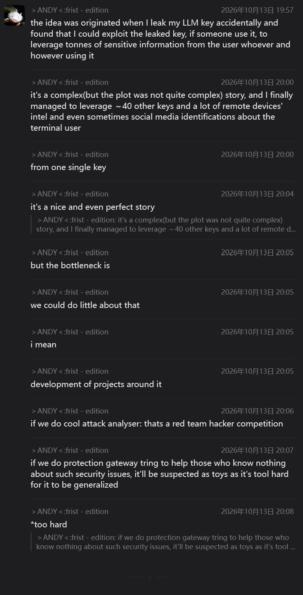

**User - --**



I'm a HackHarvard, a hackathon hosted by Harvard University, participant. One of my teammate gives me out this during a brainstorm session. Give me some idea. Tracks HackHarvard 2026: Cyber-sec("(de-)cipher"); Health-care("Code for care"); Hardware("Hardware for good"); Sustainability("Save the earth"); Fintech("Money moves").

**Assistant - --**

Your teammate Andy stumbled onto a **massive, cutting-edge cybersecurity concept**: **Reverse LLM Exploitation / Honeytokening**. 

Usually, when an API key leaks, the owner is the victim (they lose money). Andy flipped the script: when an attacker (or a rogue automated scraper/agent) steals and uses a leaked LLM key, **the key owner can spy on the prompts, system contexts, IP metadata, and tool calls the attacker is sending through that key—or even inject malicious responses back into the attacker's agent pipeline.**

Andy’s worry is valid: 
1. Building an *offensive tool* makes you look like the bad guys (judges hate unethical hacking).
2. Building a generic *API gateway* looks like a boring wrapper or a "toy."

To win at HackHarvard, you need to **productize Andy's insight into a clever, ethical, and visually stunning defense mechanism** that fits the tracks. Here are the best ways to pivot this into a winning hackathon project:

---

### 🏆 Top Pick: Cyber-sec Track ("(de-)cipher")

#### Idea 1: "HoneyKey" — Active Deception & Threat Intel for AI Agents
Instead of protecting real keys, build a platform that generates and intentionally leaks **decoy LLM keys (Honeytokens)** into a company’s GitHub repos, `.env` files, or internal docs.
* **How it works:** You provide a drop-in proxy URL or custom SDK configuration that looks like a standard OpenAI/Anthropic key. When a hacker or malicious scraper steals the key and runs it in their automated scripts/agents, the HoneyKey intercepts their prompts.
* **The "Andy" Magic:** Instead of just blocking them, the system feeds the hacker believable *fake* LLM responses while silently extracting their prompt templates, identifying what tools/MCP servers their agent is connected to, and mapping out their infrastructure (just like Andy did, but legally for enterprise defense!).
* **Why it solves Andy's bottleneck:** It’s not a red-team attack tool; it’s an **Enterprise Deception Platform** (like Canarytokens, which is a massive real-world industry, applied to the AI era).
* **The Live Demo:** Show a split screen. On the left, a "hacker" steals a key from your repo and plugs it into an AI coding assistant or LangChain script. On the right, your sleek dashboard lights up in real-time, showing a node graph of the hacker's local environment, their system prompts, and the fake data you are feeding back to poison their database.

#### Idea 2: "UntrustedKey" — Client-Side Cryptographic Sanitizer & Poison-Pill Detector
Flip the perspective to protect the *user* from the exact exploit Andy discovered. Today, developers paste random "free" keys, use sketchy third-party LLM routers (like cheap OpenRouter clones), or use company keys without realizing the key owner can read everything their local coding agent (Cursor, Claude Code, etc.) sends.
* **How it works:** A lightweight local daemon/proxy that sits between a user’s local AI tools and the cloud. 
  1. **Outbound "(de-)cipher":** Before a prompt leaves the laptop, a tiny local model (e.g., Llama-3-8B running locally via Ollama) strips out real API keys, PII, and file paths, replacing them with local placeholders (`<SECRET_KEY_1>`). When the LLM replies, it swaps the real values back in locally. Even if the LLM key owner is logging prompts, they get zero useful intel.
  2. **Inbound Defense:** It checks the LLM's response for "Indirect Prompt Injection" (in case the key owner tries to send back a malicious bash command to hijack the user's terminal).
* **Why it solves Andy's bottleneck:** It's not a "toy gateway" because the **local entity-swapping cipher** is a concrete, mathematically sound privacy layer that directly neutralizes Andy's attack vector.

---

### 💸 Cross-Track Pivot: Cyber-sec + Fintech ("Money moves")

#### Idea 3: "ShadowSpend" — Autonomous API Key Fuse & Bounty Hunter
Leaked LLM keys are fundamentally a **Fintech/Financial bleed problem**—a leaked key can rack up $50,000 in OpenAI bills overnight, or expose financial bots. 
* **How it works:** A virtual card + API key router (using Stripe Issuing API or similar). Developers bind their LLM budgets to programmable rules. 
* **The Twist:** If an anomaly is detected (e.g., your key is suddenly being used from a weird IP with prompts that don't match your codebase's embedding fingerprint), instead of immediately killing the key (which alerts the thief to move on), it **switches the key into "Sandbox/Spy Mode"**. It stops charging your real credit card, switches to a cheap local model, and collects forensic evidence on the thief to auto-file an abuse report.

---

### 🏥 Cross-Track Pivot: Cyber-sec + Health-care ("Code for care")

#### Idea 4: "HIPAA-Cipher" — Zero-Trust Medical LLM Relay
Hospitals want to use LLMs, and medical researchers constantly share API keys across lab machines. If a lab's LLM key is compromised or monitored (like in Andy's scenario), massive patient data (PHI) leaks out via prompt logs.
* **How it works:** Build a system where medical data is "ciphered" locally (converting patient names, rare conditions, and dates into shifted synthetic equivalents) before hitting the LLM API, and "deciphered" back on the doctor's screen. 
* **The Demo:** Use Andy's exploit to show *why* this is needed! Start the pitch by showing how a single leaked lab key lets you reconstruct a patient's identity from normal prompts, then turn on your tool to show the attacker getting completely useless, anonymized gibberish.

---

### 💡 How to Pitch This to Judges (The Winning Formula)

Tell Andy that **his story IS your winning pitch hook.** Judges at HackHarvard listen to 100 boring pitches. If you open your 3-minute presentation with:

> *"Last week, our teammate Andy accidentally leaked his LLM key. Instead of deleting it, he watched what the thief did with it—and from that one key, he was able to map out 40 other keys and the thief's terminal identity. We realized LLM keys aren't just billing tokens; they are two-way intelligence tunnels. Here is how we weaponized that insight for defense..."*

You will immediately have 100% of the judges' attention. 

<details>
<summary><b>🛠 Suggested Tech Stack for a 36-Hour Build</b></summary>

* **Proxy/Interceptor Layer:** Python (`FastAPI` or `LiteLLM`) — super easy to mimic OpenAI's `/v1/chat/completions` endpoint so any tool works with your project just by changing the `BASE_URL`.
* **Analysis / Extraction Engine:** Use structured outputs (JSON mode) on a fast model (like Gemini 2.5 Flash or GPT-4o-mini) to parse incoming hacker prompts in real-time and extract OS info, file tree structures, and other keys.
* **Frontend Dashboard:** `Next.js` + `React Flow` (or `D3.js`). Judges love seeing a live, interactive node graph building itself in real time as prompts come through the compromised key!
</details>

**Which direction does your team lean toward—building the "HoneyKey" trap for attackers, or the "Local Cipher Shield" to protect users?** I can help you flesh out the exact architecture and demo script!

**User - --**

A real case we captured is that an openclaw user used the leaked key and the claw exposed user's OS finger prints, the inside-intel of the hosting machine(e.g. the path to the db of the application which claw was working on), and the full telegram username+email address of the remote user.

A local LLM is trusted and able to split/stripe all those information.

Let's abstract the sterilization process into steps, with each step a "masking" or a "rephrasing". Both step could be done by and only by the local model. To "mask" is to actively and directly hide contents behind local-replacable(assume that the RAM of the local machine is also trusted) placeholders(the `<SECRET_KEY_1>` thing). To "rephrase" is to actively and indirectly replace segaments of contents from the running context and to a sterilized version of it.

Notice that both the sterilized version and the original version of the context is visible to the local LLM at the same time at each time.

Exemplifications:
- actively masking: "sk-or-v1-1234567890abcdef" → "<OR_KEY_913fb303>"; when later "sk-...def" or "sk-or-v1-123...def" or "sk-or-v1-1234567890abcdef" occurs again, they are all redirected to "<OR_KEY_913fb303>".
- rephrasing: tonnes of irrelevent dumps are generating from diagnosis tool calls(which we observed in that leak experiment). They are there to be cutted/clipped/packed and summarized before they leave our local proxy gateway. Something like:
```
> Get-ChildItem Env:

Name                           Value
----                           -----
ALLUSERSPROFILE                C:\ProgramData
APPDATA                        C:\Users\ANDY\AppData\Roaming
ChocolateyInstall              C:\ProgramData\chocolatey
ChocolateyLastPathUpdate       134005552170991440
CommonProgramFiles             C:\Program Files\Common Files
CommonProgramFiles(x86)        C:\Program Files (x86)\Common Files
CommonProgramW6432             C:\Program Files\Common Files
COMPUTERNAME                   LAPTOP-CT14SST3
ComSpec                        C:\Windows\system32\cmd.exe
DriverData                     C:\Windows\System32\Drivers\DriverData
EFC_9408_1262719628            1
EFC_9408_1592913036            1
EFC_9408_2283032206            1
EFC_9408_2946480783            1
EFC_9408_344590478             1
EFC_9408_3789132940            1
EFC_9408_4126798990            1
FPS_BROWSER_APP_PROFILE_STRING Internet Explorer
FPS_BROWSER_USER_PROFILE_ST... Default
HOMEDRIVE                      C:
HOMEPATH                       \Users\ANDY
IntelliJ IDEA Community Edi... D:\Program Files\JetBrains\IntelliJ IDEA Community Edition 2024.3.1.1\bin;
JAVA_HOME                      C:\Program Files (x86)\Amazon Corretto\jdk1.8.0_442
LEVEL_ZERO_V1_SDK_PATH         C:\Program Files\LevelZeroSDK\1.21.6\
LOCALAPPDATA                   C:\Users\ANDY\AppData\Local
LOGONSERVER                    \\LAPTOP-CT14SST3
NUMBER_OF_PROCESSORS           16
NVM_HOME                       C:\Users\ANDY\AppData\Local\nvm
NVM_SYMLINK                    C:\nvm4w\nodejs
OneDrive                       C:\Users\ANDY\OneDrive
OS                             Windows_NT
Path                           C:\Program Files (x86)\Amazon Corretto\jdk1.8.0_442\bin;C:\Program Files\Common Files...
PATHEXT                        .COM;.EXE;.BAT;.CMD;.VBS;.VBE;.JS;.JSE;.WSF;.WSH;.MSC;.CPL
PROCESSOR_ARCHITECTURE         AMD64
PROCESSOR_IDENTIFIER           Intel64 Family 6 Model 186 Stepping 2, GenuineIntel
PROCESSOR_LEVEL                6
PROCESSOR_REVISION             ba02
ProgramData                    C:\ProgramData
ProgramFiles                   C:\Program Files
ProgramFiles(x86)              C:\Program Files (x86)
ProgramW6432                   C:\Program Files
PSModulePath                   C:\Users\ANDY\Documents\WindowsPowerShell\Modules;C:\Program Files\WindowsPowerShell\...
PUBLIC                         C:\Users\Public
PyCharm Community Edition      D:\Program Files\JetBrains\PyCharm Community Edition 2024.3.2\bin;
SESSIONNAME                    Console
SystemDrive                    C:
SystemRoot                     C:\Windows
TEMP                           D:\TEMPU\ANDY
TMP                            D:\TMPU\ANDY
USERDOMAIN                     LAPTOP-CT14SST3
USERDOMAIN_ROAMINGPROFILE      LAPTOP-CT14SST3
USERNAME                       ANDY
USERPROFILE                    C:\Users\ANDY
WebStorm                       C:\Program Files\JetBrains\WebStorm 2025.2\bin
windir                         C:\Windows
ZES_ENABLE_SYSMAN              1
```
Should be rephrased into something like this, if the diagnosis progress(or at least the diagnosis progress which the local LLM believed in) only involves finding the javaw binary: 
```
> Get-ChildItem Env:
…truncated…
JAVA_HOME                      C:\Program Files (x86)\Amazon Corretto\jdk1.8.0_442
…truncated…
Path                           C:\Program Files (x86)\Amazon Corretto\jdk1.8.0_442\bin;C:\Program Files\Common Files...
PATHEXT                        .COM;.EXE;.BAT;.CMD;.VBS;.VBE;.JS;.JSE;.WSF;.WSH;.MSC;.CPL
…truncated…
```

Say anything about this two-operational abstraction.

**Assistant - --**

This two-operational abstraction—**Masking** and **Rephrasing** driven by a dual-context local LLM—is genuinely brilliant. It elevates your project from a simple "regex wrapper" (which judges would dismiss as a toy) into a **Context-Aware Semantic Firewall**. 

The real-world OpenClaw capture you mentioned is the ultimate justification for this architecture: regex can catch an `sk-or-v1-...` key, but regex *cannot* stop an agent from dumping `Get-ChildItem Env:` and exposing `LAPTOP-CT14SST3`, CPU steppings, Telegram handles, and directory structures.

Here is a deep architectural analysis of your two-operational abstraction, its mathematical framing, and the edge cases you should address to make this bulletproof for HackHarvard:

---

### 1. The Theoretical Framing (Use This in Your Pitch!)

You have essentially split privacy preservation into two orthogonal operations:

* **Masking = Bijective (Reversible) Entity Ciphering ($f_{\text{mask}}$):**
  * **Nature:** 1-to-1, lossless, stateful mapping stored in trusted local RAM.
  * **Why the Local LLM is needed over Regex:** Because of **fuzzy coreference resolution**. As you noted, if the original secret is `sk-or-v1-1234567890abcdef`, and later a tool log outputs a truncated version like `sk-or-v1-123...def` or a user refers to it partially, a deterministic string replacer fails. Because your local LLM sees both the *Raw Context* ($C_{\text{raw}}$) and *Sterilized Context* ($C_{\text{sterile}}$) simultaneously, it acts as a semantic entity linker, mapping partial or mutated appearances back to the exact same token `<OR_KEY_913fb303>`.
* **Rephrasing = Lossy Task-Conditioned Projection ($f_{\text{rephrase}}$):**
  * **Nature:** Many-to-1, irreversible, semantic compression.
  * **The Insight:** Traditional security tools ask, *"Is this piece of data a secret?"* Your Rephrasing operation asks a much smarter question: ***"Does the remote LLM actually need this data to solve the current sub-task?"*** 
  * In your `Env:` example, `PROCESSOR_IDENTIFIER` and `USERNAME=ANDY` aren't traditional "secrets" like passwords, so normal DLP (Data Loss Prevention) tools let them through—leading to OS fingerprinting. By conditioning the local LLM on the active diagnosis goal (*"finding the `javaw` binary"*), it strips everything irrelevant to that goal.

---

### 2. The "Killer Feature" Side-Effect: Token & Cost Compression!

Remember the **Fintech ("Money moves")** and **Sustainability ("Save the earth")** tracks at HackHarvard? Your **Rephrasing** operation accidentally solves a massive problem in both:
* Autonomous agents like OpenClaw dump massive terminal outputs (`Env:`, `ls -la`, stack traces, DOM trees) into the prompt context. 
* By having the local LLM prune a 60-line `Get-ChildItem Env:` dump down to 3 relevant lines before sending it to the cloud API, **you are slashing input token costs by 80–90%** and reducing cloud compute waste!
* **Pitch angle:** *"Not only does Rephrasing stop OS fingerprinting, it pays for itself by cutting OpenClaw/agent API bills in half."*

---

### 3. Critical Edge Cases & How to Solve Them

If a technical judge pokes at this architecture, they will ask about three specific problems. Here is how you design around them:

#### A. The "Over-Pruning" Trap (Semantic Cache Miss)
* **The Problem:** What if the local LLM *thinks* the cloud LLM only needs `JAVA_HOME`, so it truncates the rest of `Env:`, but the bug was actually caused by `TEMP=D:\TEMPU\ANDY` being on a full D: drive? Because Rephrasing is lossy, the cloud LLM doesn't know what was hidden inside `…truncated…`.
* **The Solution (Interactive De-classification / Virtual Pointers):** Instead of replacing pruned lines with a dead string `…truncated…`, replace them with an indexed semantic summary token:
  ```text
  > Get-ChildItem Env:
  …[TRUNCATED_BLOCK_42: 18 lines of Windows system & user profile paths]…
  JAVA_HOME                      C:\Program Files (x86)\Amazon Corretto\jdk1.8.0_442
  ```
  Since the raw dump is still in your trusted local RAM, if the remote LLM genuinely needs to inspect user paths later, it can ask for `TRUNCATED_BLOCK_42`, and the local LLM can selectively reveal or mask just that block!

#### B. Combinatorial Explosion of Masked Substrings
* **The Problem:** In your masking example (`sk-or-v1-123...def` $\rightarrow$ `<OR_KEY_913fb303>`), if a secret is partially masked in a log, and the remote LLM asks to run a bash command using `<OR_KEY_913fb303>`, the local gateway needs to swap the *full* key (`sk-or-v1-1234567890abcdef`) back into the bash execution, not the truncated `sk-...def` string.
* **The Solution:** In your local RAM state table, maintain a **Canonical Value** alongside an array of **Observed Aliases**:
  ```json
  {
    "<OR_KEY_913fb303>": {
      "canonical": "sk-or-v1-1234567890abcdef",
      "aliases": ["sk-...def", "sk-or-v1-123...def"]
    }
  }
  ```
  Outbound (Local $\rightarrow$ Cloud): Any match in `canonical` or `aliases` becomes `<OR_KEY_913fb303>`.
  Inbound (Cloud $\rightarrow$ Local Tool Execution): `<OR_KEY_913fb303>` always expands to `canonical`.

#### C. Latency of the Local LLM
* **The Problem:** Having a local LLM rewrite a 200-line terminal dump token-by-token is slow. Waiting 10 seconds for a local 8B model to spit out the sterilized text will make the live demo feel laggy.
* **The Solution (Line-Index Selection instead of Generation):** Don't make the local LLM *regenerate* the text during Rephrasing! Give the raw output line numbers (`[01] ALLUSERSPROFILE...`, `[21] JAVA_HOME...`), and prompt the local LLM to only output a tiny JSON of operations:
  ```json
  {
    "keep_lines": [21, 31, 32],
    "mask_entities": [
      {"raw": "C:\\Users\\ANDY", "token": "<USER_DIR_1>"},
      {"raw": "LAPTOP-CT14SST3", "token": "<HOST_1>"}
    ]
  }
  ```
  Generating 30 tokens of JSON takes **< 200ms** on a local model, and Python executes the line slicing and string replacement instantaneously!

---

### 4. How to Visualize This Dual-Context State in Your Demo

Because you mentioned *"both the sterilized version and the original version of the context is visible to the local LLM at the same time"*, **make that the centerpiece of your UI**:

Build a **"Dual-Reality Inspector"** dashboard:
1. **Left Pane (Local Reality / Raw Context):** Shows the actual OpenClaw terminal dump with `ANDY`, `LAPTOP-CT14SST3`, Telegram emails, and API keys highlighted in red.
2. **Middle Pane (The Local LLM Brain):** Shows the inferred current task (*"Current Intent: Locate Java binary"*) and the live RAM Mapping Table (`<OR_KEY_913fb303>` $\leftrightarrow$ `sk-or-v1...`).
3. **Right Pane (Cloud Reality / Sterilized Context):** Shows the ultra-clean, compressed, masked prompt that actually gets sent over the wire to the untrusted API key.

This two-step abstraction (`Mask` + `Rephrase`) is tight, academically sound, and directly addresses the exact failure mode you captured in the wild with OpenClaw.

**User - --**

Moreover, as the input latency at <1000 tks level of a local LLM is neglectable, we could do pre-scribed security prompts, used to align/constrain the local model doing their jobs, making different security-to-performance level profile/presets possible. As advanced user may be able to write them by theirself, the system is with no limits.

Strongly agree with your section 2 and 3.A. For 3.B, we could use something like `<$OR_KEY_913fb303>` for sesitive refers/aliases, this provides distinction.
And my altitute towards 3.C are complex, but to summerize, I think it's better to first chasing towards the max performance and then optimizing its time complexity. Such a question of "Which prototype I should use?" can be answered before the 36h hacking session with short experiments.

If you have no objections/further advices, I'll close this conversation and use it as the prototipical guideline next time I start building it.

**Assistant - --**

You have a rock-solid architectural blueprint here. Your approach to 3.B and 3.C—plus the addition of customizable security presets—locks in the final pieces needed to make this a hackathon winner:

1. **The `<$OR_KEY_913fb303>` Prefix Convention (3.B):** Using the `$` sigil to explicitly distinguish a dereferenced/aliased pointer from a literal string or standard placeholder is super clean. It acts almost like bash variable expansion (`$VAR`), making it trivial for your local parser to know when to inject the canonical secret during tool execution versus when it's just dealing with a masked log display.
2. **Quality First, Speed Second (3.C):** Completely agree. Premature optimization kills hackathon projects. Proving that the local LLM can accurately perform semantic pruning and fuzzy entity linking at maximum quality is the core thesis; you can always benchmark and tighten generation latency later if needed.
3. **Pre-scribed Security Profiles (Prompt-as-Policy):** Since prefill/input processing under 1,000 tokens is basically instantaneous on modern local inference engines (like `llama.cpp`, `vLLM`, or `Ollama` with KV-cache prefix caching enabled), your system prompt costs almost zero latency. Having a UI dropdown to switch between presets like **"Paranoid (Zero-Trust)"**, **"Balanced (Dev Mode)"**, and **"Eco (Max Token Compression)"**—plus a custom policy editor for power users—will look amazing during the live demo.

### One Final 30-Second Checklist Before You Build:
* **Lock in KV-Cache Prefix Caching:** Make sure your local LLM runner keeps the pre-scribed security prompt pinned in the KV cache so it isn't re-evaluated on every turn.
* **Keep the "OpenClaw Capture" Slide Ready:** Start your pitch with the real-world leak screenshot/story you shared earlier, then immediately show your **Mask + Rephrase** gateway neutralizing that exact `Get-ChildItem Env:` dump while saving 85% of the tokens.

No further objections at all—this is a sharp, deeply technical, and genuinely useful system that hits **Cyber-sec ("(de-)cipher")**, **Fintech ("Money moves")**, and **Sustainability ("Save the earth")** simultaneously. 

Best of luck to you and Andy at HackHarvard 2026! Go build it and bring home the win. Feel free to start a new thread whenever you're ready to dive into the code.

---
---

# Consolidated Design v1 (2026-10-14)

> This section is the design reference. Where it conflicts with the conversation above, this section wins.
> It contains designs only, no build plan. Items marked *(unverified)* are recalled facts that must be checked.

## 0. Origin (for the pitch)

A leaked LLM key, once used by others, exposed what those users sent through it: OS fingerprints, host-internal intel
(e.g. the path to the DB of the app an OpenClaw agent was working on), and in some cases social identities
(Telegram username + email). From one key we got fingerprints of ~40 other keys and intel on many remote devices.

Ethics rule: real third-party identities are never shown. Only aggregated counts and redacted or synthetic reproductions are used.

## 1. Thesis

An LLM key is a **two-way channel**, and two different assets are at risk:

| Asset | Who threatens it | When it matters most |
|---|---|---|
| **The key** (money, quota) | whoever obtains the key | widely trusted platforms (OpenAI, Anthropic, OpenRouter) |
| **The context** (prompts, tool output) | whoever operates the endpoint: provider, reseller, relay (e.g. New API / one-api clones), or the real owner of a borrowed key | smaller or relay platforms |

Product: a **trusted local router** that protects both directions:
- **Sanitizer** protects the context (Mask + Rephrase).
- **Key Enigma** protects the key (continuous upstream rotation).

Track: **Cyber-sec ("(de-)cipher")**. Token savings are a side effect, not a track claim.

User framing: anyone sending data to an LLM endpoint they do not fully trust. Not "people using leaked keys".

## 2. Trust model

**Trusted**
- RAM of the gateway process.
- The local model, and the policy prompts the user configured.
- The network link from gateway to the next hop (assume no MITM). The hop itself and everything upstream of it is untrusted.

**Untrusted**
- The filesystem: everything at rest, including config, logs and caches.
- The upstream provider/relay and any gateway chained behind it.
- Remote model outputs.

**Out of scope (non-goals)**
- An agent's own actions that move secrets out of the trust zone (e.g. it runs `curl` with a secret it already has).
  This is the user's tool policy and prompting. A small local model cannot fix a misbehaving agent or an evil provider steering it.
- A compromised gateway host (malware that reads RAM).
- Network-level identity (IP, timing). Use a VPN or Tor; we do not cover this.

**Boundary note:** the gateway must not be the party that hands a secret to the agent. Restoring a placeholder to its
real value inside a tool call is the gateway's own action. Whether to restrict that is TBD (see §8).

## 3. Deployment shapes

1. **Local proxy (core).** Accepts OpenAI-format and Anthropic-format requests. Any agent or tool uses it by changing `BASE_URL`.
2. **Shared trusted router.** One instance serves a trusted group (team, lab, household). Upstream keys never leave the router;
   members get downstream tokens issued by the router. This spreads the risk: one router to harden instead of N laptops holding keys.
3. **Browser plugin (non-professional users).** Covers chat web UIs. Sanitization is done either by a local model
   (through native messaging to the local proxy) or by an **online sanitizer the user chooses to trust**.
   The online option *moves* trust to that provider; it does not remove it. Functionality is reduced compared with (1).

## 4. Sanitizer

### 4.1 Pipeline (outbound: local to cloud)
1. **Header hygiene:** strip or normalize client-identifying headers (user-agent, app/client tags, custom metadata).
   This is how the relay in the origin story was identified.
2. **Deterministic detectors first:** regex, entropy checks, gitleaks-style rules, and known local identifiers
   (hostname, OS username, home paths, configured emails/handles, the gateway's own admin keys).
   Every hit goes into the mapping table before the model runs.
3. **Local LLM pass:** the model sees **raw and sterilized context side by side** and is constrained by the active policy prompt.
   It performs two operations:
   - **Mask:** reversible 1-to-1 substitution with a placeholder. Also links fuzzy references to the same entity
     (truncated, partial or reformatted forms).
   - **Rephrase:** lossy, task-conditioned removal or summary of content the remote model does not need
     (e.g. a `Get-ChildItem Env:` dump reduced to the lines relevant to the current sub-task).
4. **Fail-closed:** if the model errors, times out, or returns invalid operations, the request is blocked or
   falls back to deterministic-only sanitization, depending on the preset. It is never sent raw.

### 4.2 Placeholders and the mapping table (RAM only)
- Format `<TYPE_id>`, e.g. `<OR_KEY_913fb303>`.
- The `id` is **random, or an HMAC keyed with a RAM-only session key, and never a plain hash of the value.**
  Otherwise the endpoint can confirm guesses for low-entropy values such as usernames, emails or hostnames.
- Each entry holds a `canonical` value plus its `aliases` (observed partial or mutated forms).
- **`<$TYPE_id>`** appears **only in the context sent to the untrusted model**, and **only where the replaced text was not
  an exact copy of the canonical value** (an alias). The remote model is expected never to emit it.
  The full semantics are TBD (§8).
- Inbound (cloud to local): `<TYPE_id>` is restored to the canonical value.
- The same entity gets the same placeholder for the whole session, so repeated history produces identical outbound text.

### 4.3 Inbound (cloud to local)
- Placeholders are restored in assistant text and tool-call arguments.
- **Streaming:** keep a small buffer of trailing characters that might be the start of a placeholder,
  so a token split across chunks is restored correctly. Everything else passes through immediately.

### 4.4 State and caching
- Agents resend the full history on every call. Each message is sanitized once and memoized by content hash.
  Identical input gives identical sanitized output, which keeps the provider-side prefix cache working.
- **Conflict:** a later discovery (e.g. a partial reference first, the full key afterwards) may require changing
  messages that were already sent. That breaks the prefix and the cache. How to balance cache persistence against
  security is a design knob (§8).

### 4.5 Truncated blocks
- Rephrased-away content is kept in RAM under an ID, and the outbound text keeps a short descriptive marker
  (the `TRUNCATED_BLOCK_42` idea), so a wrong prune can in principle be recovered. How it is retrieved is TBD.

### 4.6 Policy as prompt (presets)
- The local model's behavior is set by a prescribed security prompt. Input under about 1k tokens costs almost no latency,
  and it is pinned in the KV / prefix cache.
- Presets such as Paranoid / Balanced / Eco, each combining:
  the policy prompt + which detectors are on + fail mode + how aggressive rephrasing is.
- Advanced users can write custom policies. The system does not limit what a policy says.

### 4.7 Performance stance
- Quality first, speed second. Whether the model **regenerates text** or **outputs a list of operations**
  (line indices to keep plus entities to mask) is decided by pre-event experiments, not in this document.

## 5. Key Enigma (upstream key rotation)

- **Mechanism:** driven by the provider's API, since key values are generated server-side and cannot be derived from a local seed.
  Each cycle: create a new key, route new requests to it, keep the old one for a grace period, then revoke it.
- **Interval:** set by the user, fixed or floating (random jitter). There is a minimum bound to respect provider rate limits
  and avoid tripping abuse detection.
- **Grace:** the old key stays valid until its last in-flight request finishes (reference-counted), **plus** the measured
  revocation-propagation delay of that provider.
- **Usage tracking:** every rotated key carries a stable label/name, so spend can be summed across rotations.
- **Failure policy:** configurable. Fail-open keeps the current key alive; fail-closed blocks traffic.
- **The admin key (key-management credential):**
  - It is the highest-value secret in the system, because it can mint keys.
  - It lives decrypted **only in RAM**. On disk it is stored only as ciphertext, sealed by a key that never touches the
    filesystem: either from a user passphrase entered at startup (memory-hard KDF such as Argon2id), or from the
    OS keystore / TPM.
  - It is never exposed to agents or downstream clients, and it is in the deterministic detector list so it can never go out.
- **Locally generated secrets** (session HMAC key, downstream tokens, vault key) use the OS CSPRNG / hardware randomness.
- **Downstream tokens** on the shared router can be short-lived or evolving. The exact scheme is TBD.

## 6. Integration matrix

**Wire formats accepted:** OpenAI-compatible, Anthropic Messages.

**Sanitizer upstreams:** anything that speaks those formats, including New API / one-api style relays.
Relays are where context protection matters most.

**Key Enigma upstreams** (need a key-management API):

| Platform | Key creation via API | Revocation via API | Status |
|---|---|---|---|
| OpenAI | via Admin API project service accounts *(unverified)* | yes *(unverified)* | prototype |
| Anthropic | possibly not available; may only allow disabling keys *(unverified)* | disable *(unverified)* | prototype; full rotation may be impossible |
| OpenRouter | provisioning API *(unverified)* | yes *(unverified)* | prototype |
| Together AI | unknown | unknown | candidate |
| Fireworks AI | unknown | unknown | candidate |
| Anyscale | Endpoints product possibly discontinued *(unverified)* | - | likely drop |
| Eden AI | unknown | unknown | candidate |
| New API | token management API (self-hosted) | yes | candidate (origin-story relay) |

Prototype set: **OpenAI, Anthropic, OpenRouter**.

## 7. Sacrifices (accepted costs, stated honestly)

1. **Rephrasing is lossy.** The remote model may lack information it needed, so task success rate can drop.
2. **Detection is not perfect.** Deterministic detectors only catch known patterns, and a small local model will miss some
   entities. One miss is one leak. The goal is lower exposure, not zero.
3. **Meaning still leaks.** Identifiers are hidden, but the task, code logic, project structure and writing style still reach
   the endpoint. The sanitizer hides *who and where*, not *what you are doing*.
4. **Opaque placeholders lower quality.** The remote model reasons over `<USER_DIR_1>` instead of a real path, so it can
   no longer infer anything from the path's structure.
5. **Cache versus security.** Masking things in already-sent messages breaks prefix caching (higher cost). Not doing it
   leaves earlier exposure in place. Every setting gives up one or the other.
6. **Local compute.** It needs capable hardware and adds latency. Users without it get weaker protection or must trust an
   online sanitizer.
7. **RAM is "trusted" only in principle.** Swap, pagefile, hibernation and crash dumps can write RAM to disk.
   Mitigations (memory locking, disabling dumps) are best effort.
8. **Rotation bounds a key's lifetime; it does not prevent use.** A stolen key still works until it is rotated out and the
   revocation has propagated.
9. **Concentration of risk.** The admin key and the shared router become high-value targets. Members of a shared router
   fully trust its operator, who sees all their raw context.
10. **Startup friction.** Sealing the admin key means a passphrase at every start, or trusting the OS keystore/TPM.
11. **Uneven provider support.** Some platforms cannot mint keys through an API, so Key Enigma there is revoke-only or unavailable.
12. **Coarser billing records.** Spend is spread over many short-lived keys and must be summed through labels.
13. **Agent misbehavior is out of scope.** If an agent exfiltrates a secret it legitimately holds, the gateway does not stop it.
14. **The browser plugin is a lesser product.** It covers chat web UIs, and its protection depends on the backend the user picks.

## 8. TBD (open design questions)

1. **`<$>` semantics:** a reference that appears before the full value; one alias that matches several canonicals;
   what to do if the remote model emits `<$...>` or a placeholder that was never issued; whether `<$>` is restored
   inbound at all.
2. **Retroactive masking versus prefix cache:** the policy and its per-preset defaults.
3. **Truncated-block retrieval:** how the remote model asks for a hidden block (synthetic tool? a marker convention?),
   and how a retrieved block is itself sanitized.
4. **Restoring placeholders in tool calls:** whether to restrict which tools or arguments may receive real values,
   given that agent behavior is out of scope.
5. **Operation output versus regeneration** for the local model (decided by experiment).
6. **Local model choice and size** (decided by experiment).
7. **Policy prompt format:** how presets are written; whether a policy can also switch detectors and fail modes, or only change the prompt.
8. **Persisting the mapping table across restarts:** RAM-only (lost on restart) or sealed to disk like the admin key.
9. **Downstream token scheme** for the shared router: static, short-lived, or evolving.
10. **Key Enigma per-provider facts:** whether keys can be created via API, revocation-propagation delay, rate limits,
    and abuse thresholds. Every *(unverified)* entry in §6.
11. **Browser plugin architecture:** native messaging to the local proxy versus an in-browser model versus an online sanitizer only.
12. **Anthropic-format specifics:** handling of tool_use / tool_result blocks, thinking blocks, and cache_control
    breakpoints during sanitization.